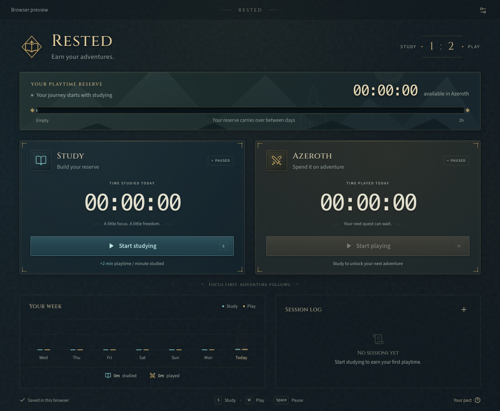

# Rested

**Earn your adventures.** A WoW-inspired macOS desktop timer: one minute of studying earns two minutes of playtime.



## Features

- Two mutually exclusive timers for studying and playing WoW.
- A rested-XP-style reserve bar, with earned playtime that carries across days.
- Native notifications when your reserve runs out—no debt and no forced game shutdown.
- Editable session history: add, change, and delete entries with a reserve preview.
- Daily totals, a seven-day activity chart, and keyboard shortcuts.
- Local-only persistence, native sleep handling, and a Rust-owned clock.
- Tauri 2 + React/TypeScript, with future macOS menu-bar support built into the stack.

## Run

Requires macOS 13+, Node.js 22.12+ (or 20.19+), Rust, and the Xcode command-line tools.

```sh
git clone https://github.com/mastorm/rested.git
cd rested
npm install
npm run desktop
```

For a browser-only UI preview, run `npm run dev` and open `http://127.0.0.1:1420`. Browser preview data is intentionally separate from the native app.

Quit a running packaged copy before starting development: Rested only allows one native instance at a time.

## The rules

- Start **Study** to earn playtime at 2×, or **Azeroth** to spend it at 1×.
- Only one timer runs at a time. Starting the other timer switches modes.
- At zero, the play timer stops. There is no debt, and **the app does not close or restrict WoW**. Playing beyond zero is not recorded.
- Unspent playtime carries across days. The two main clocks show today's totals; the reserve includes all days.
- Minimizing does not pause a timer. System sleep and quitting do. Restarting always opens paused.
- Enable notifications in Preferences and allow macOS notification permission. An in-app warning is always shown at zero.
- Keyboard: **S** toggles studying, **W** toggles playing, **Space** pauses the active timer. Shortcuts are inactive inside dialogs or text fields.

## Manage the session log

- Drag the top **RESTED** title bar to move the native window. The Preferences button remains clickable.
- Click **+** next to Session log to add a completed study or WoW session. Choose the activity, local start date/time, and duration (`HH:MM:SS`; optional milliseconds are preserved).
- Use the pencil or trash button beside an entry to edit or delete it. Deletion requires confirmation.
- **View all sessions** opens the full retained history, with pagination and the same editing controls.
- Corrections immediately update your reserve, daily clocks, and weekly chart. A reserve preview shows the effect before saving.
- Corrections that would make recorded playtime exceed earned time are rejected—there is no hidden debt. Adjust play entries or add study time first.
- Pause the currently running session before editing or deleting it. Other entries can be changed while a timer runs. If a correction empties a running play timer's reserve, it stops automatically.
- Existing ledgers remain compatible; adding, editing, or deleting a retained entry does not reset older archived totals. Changes are committed only after saving succeeds.

## Build a macOS app

```sh
npm run tauri -- build
```

The app and disk image are generated in `src-tauri/target/release/bundle/`. Local builds are unsigned/not notarized; distributing outside your own machine requires Apple signing and notarization.

## Verify

```sh
npm test
npm run test:rust
npx playwright install chromium webkit
npm run test:e2e
npm run build
```

Rust tests cover the earning ratio, mutually exclusive modes, exact zero cutoff, paused/sleep time, midnight rollover, persistence, session corrections, legacy ledger compatibility, and refusing corrupted ledgers. Chromium and WebKit tests exercise controls, shortcuts, dialog focus, reload behavior, empty budgets, manual session management, full-history pagination, native drag command wiring, small screens, and automated accessibility checks.

## Architecture

- **Tauri 2** hosts a React/TypeScript UI in the macOS system WebView.
- **Rust owns all native timekeeping.** A monotonic clock accounts for elapsed time; UI intervals do not grant or spend time. Sub-second credit is preserved.
- A native IOKit power observer pauses before macOS sleeps. A clock-gap safeguard also pauses after an unexpected suspension or a process stall longer than five seconds.
- An atomic JSON ledger is saved after timer changes, every five seconds while dirty, and on clean exit. A force quit/crash can lose at most the most recent unsaved checkpoint. There is no offline accrual.
- Totals and daily history are kept, plus the most recent 1,000 sessions (six sent to the UI). Corrupt or incompatible native data fails safely rather than silently resetting your balance.
- Storage failures pause the timers and show an error; saving is retried automatically.
- Only one native instance can own the ledger. Opening Rested again focuses the existing window.
- Fonts and original SVG artwork are bundled locally. No Blizzard assets, accounts, servers, analytics, or network services are used at runtime.

Native data lives at `~/Library/Application Support/dev.rested.desktop/state.json`. The browser preview uses the `rested.preview.v1` localStorage key. For a backup, quit Rested and copy the native ledger.

The release profile disables Rust's built-in stripping to avoid [a Rust 1.95 / macOS 27 linker issue](https://github.com/rust-lang/rust/issues/157750). This is project-local; no system toolchain changes are required.

### Future menu-bar support

The Tauri `tray-icon` feature is already enabled. The timer is managed by the app, not its window, so a future menu-bar icon can show the reserve and start/pause modes without replacing the stack. Closing the window currently quits; a tray version can change that to hide-to-menu-bar.

---

An unofficial personal project, not affiliated with Blizzard Entertainment. Artwork is original; bundled font and frontend license notices are in [`public/THIRD-PARTY-NOTICES.txt`](public/THIRD-PARTY-NOTICES.txt).
